# GoStudios

> Building **GoConsoleOS™** — a fast, modern, controller-friendly gaming console shell for Windows.

## About

GoStudios makes **GoConsoleOS™**, an all-in-one gaming console experience for PC. It turns your Windows machine into a living-room console with a gamepad-driven interface, curated store, achievements, friends, and more.

## Highlights

| Area | What you get |
|------|--------------|
| 🎮 **Controller-first UI** | Navigate everything with a gamepad, mouse emulation included |
| 🛒 **GoStore** | Curated games & apps with one-click download and launch |
| 🏆 **Achievements** | Persistent unlock tracking across the whole OS |
| 🎵 **GoAudio** | Xbox + PS5 inspired procedural sound engine |
| 💾 **Backup & Restore** | Profiles, saves and screenshots, safe on demand |
| 🌙 **Night Mode** | Dim the whole experience |
| 🎨 **Themes & Accents** | Pick your colors and wallpapers |

## Supported CPUs

GoConsoleOS auto-detects your hardware and shows your tier in Settings → About:

| Tier | Level |
|------|-------|
| Intel Core i5 / i7 / i9 | Good / Great / Excellent |
| AMD Ryzen 3 / 5 / 7 / 9 | Entry / Good / Great / Excellent |
| Other Intel & AMD | General gaming ready |

## The Collection

Browse the GoConsoleOS asset library — 50 banners, 50 icons and 50 logos, all themed for the console.

### Banners

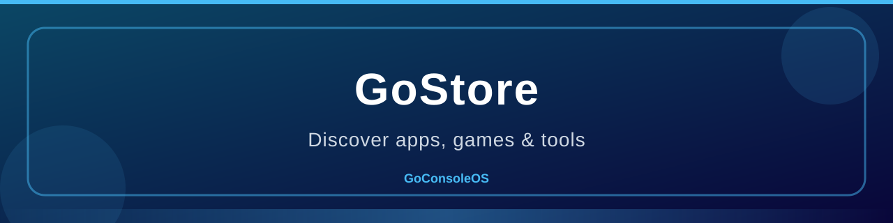 | 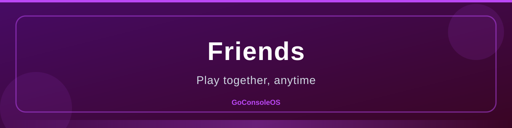 | 
|---|---|---|
 |  | 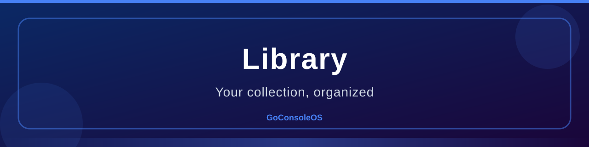
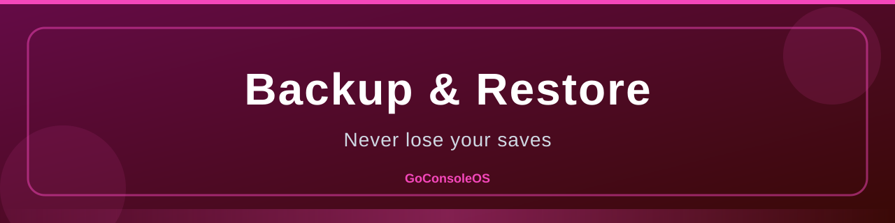 |  | 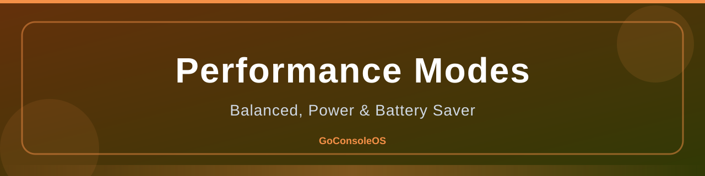
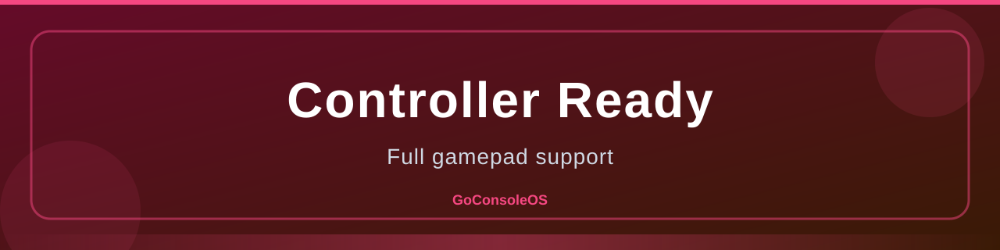 | 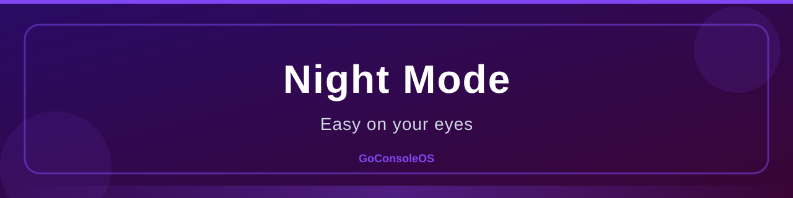 | 
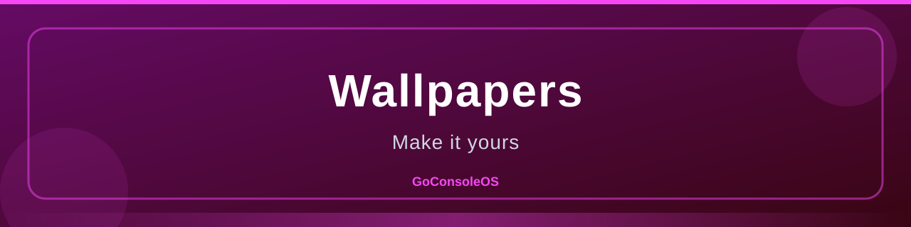 | 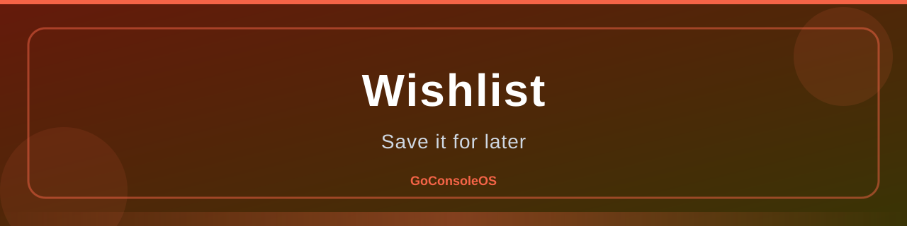 | 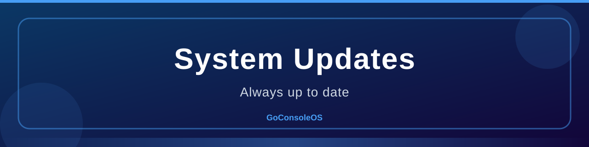
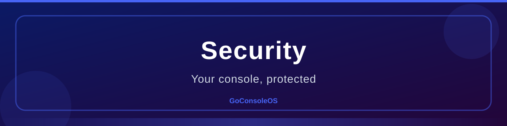 |  | 
 | 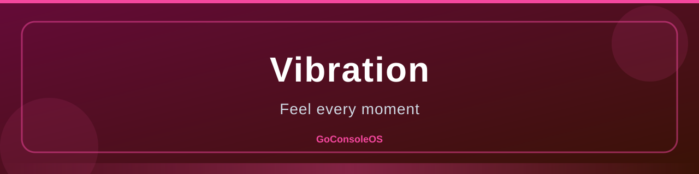 | 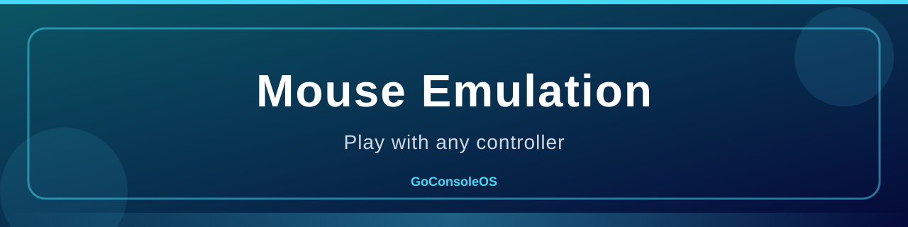
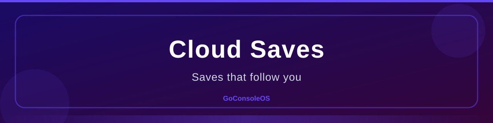 | 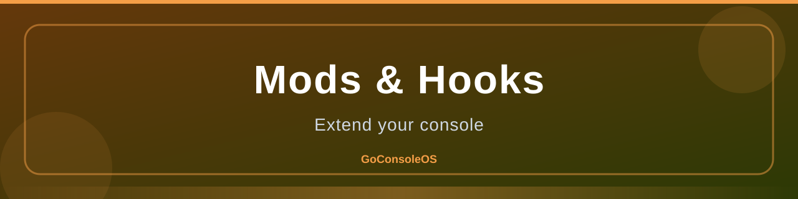 | 
 | 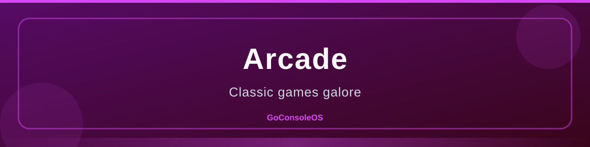 | 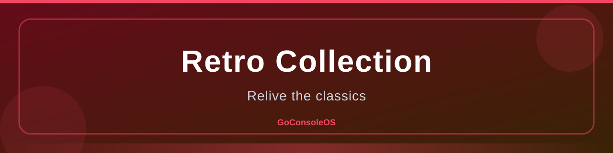
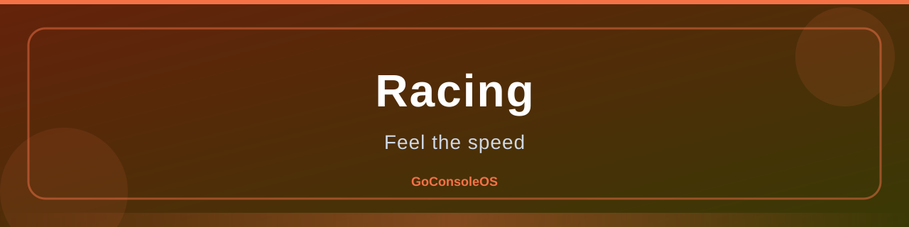 |  | 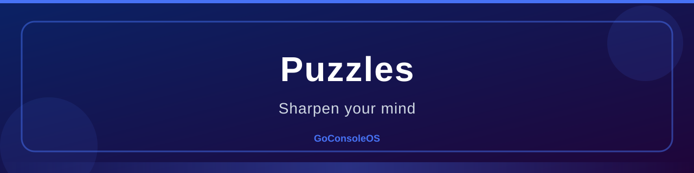
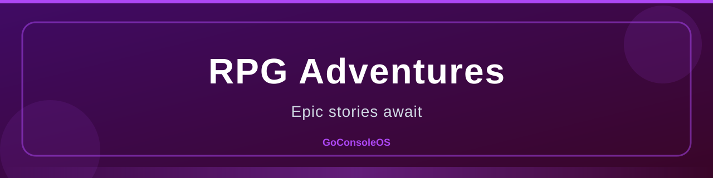 |  | 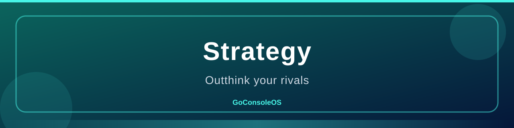
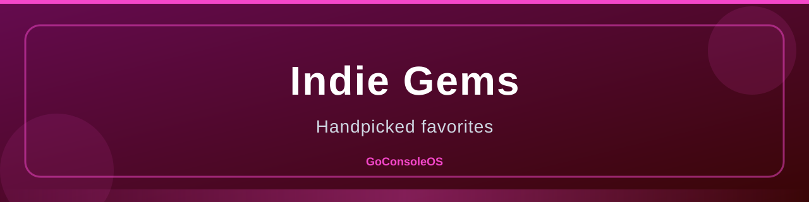 |  | 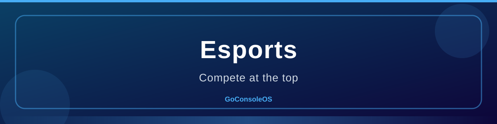
 | 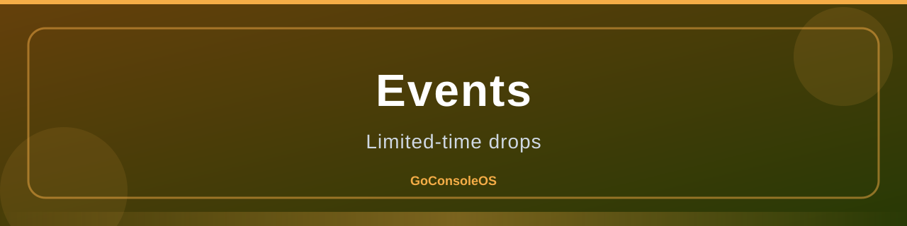 | 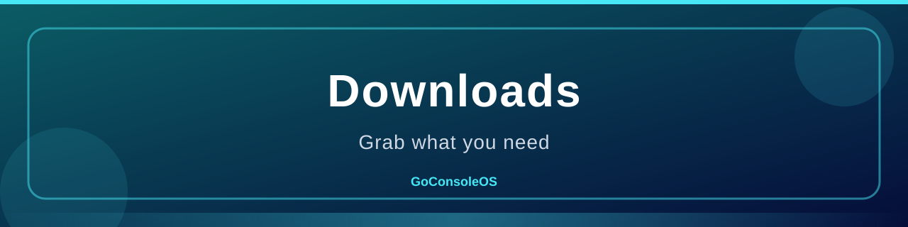
 | 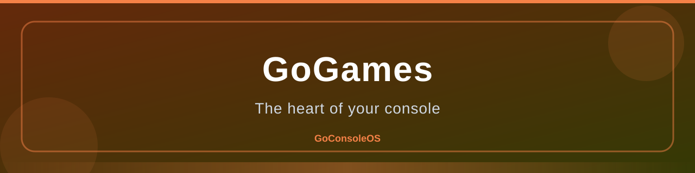 | 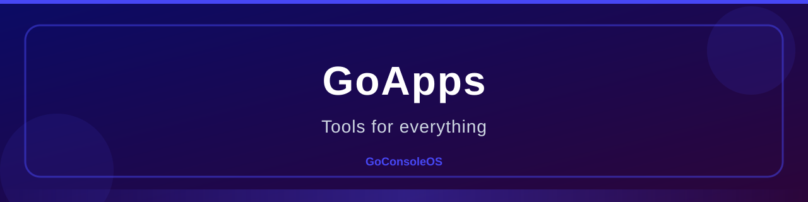
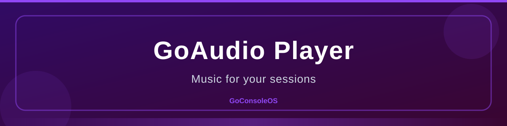 | 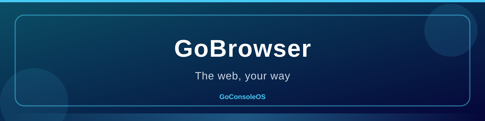 | 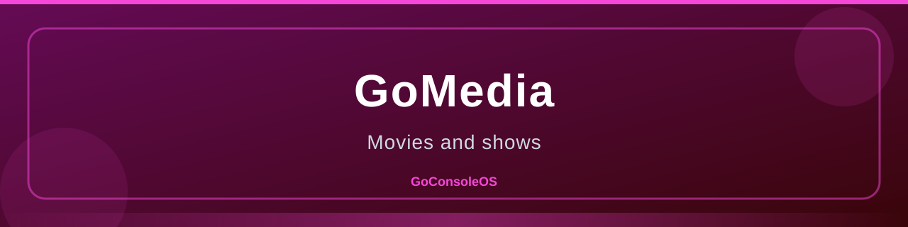
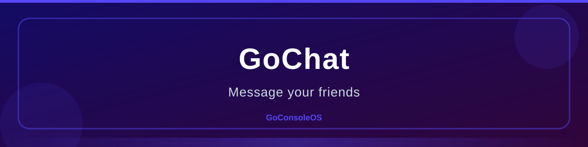 |  | 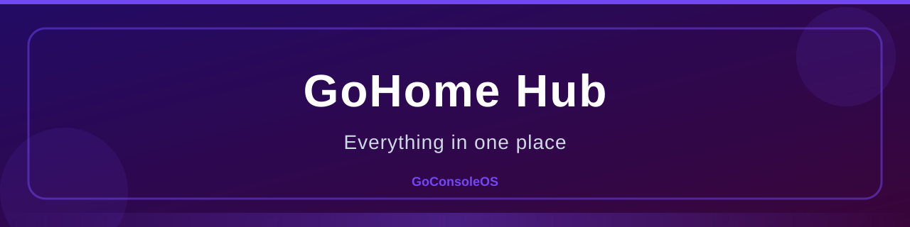

### Icons

 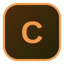   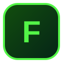 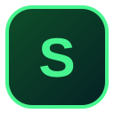  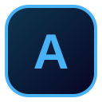 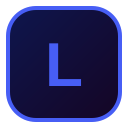 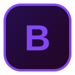
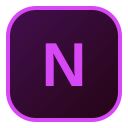 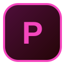 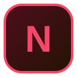 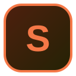    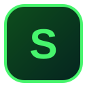 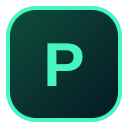 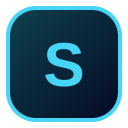
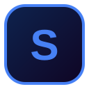  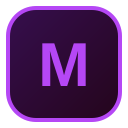 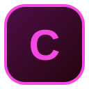 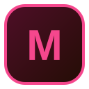 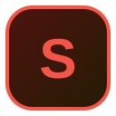    
         
         

### Logos

    
    
    
    
    
    
    
    
    
    

## Where to find us

- 🕹️ **GoConsoleOS repo** → [`GoStudios-Real/GoConsoleOS`](https://github.com/GoStudios-Real/GoConsoleOS)
- ⭐ Star the repos to support the project!

## Stack

---

**GoConsoleOS™** and the **GoConsoleOS logo** are trademarks of **GoStudios**.
Intel Core i5/i7/i9 are trademarks of Intel Corporation. AMD Ryzen is a trademark of Advanced Micro Devices, Inc.

**Copyright © 2026 GoStudios. All rights reserved.**
